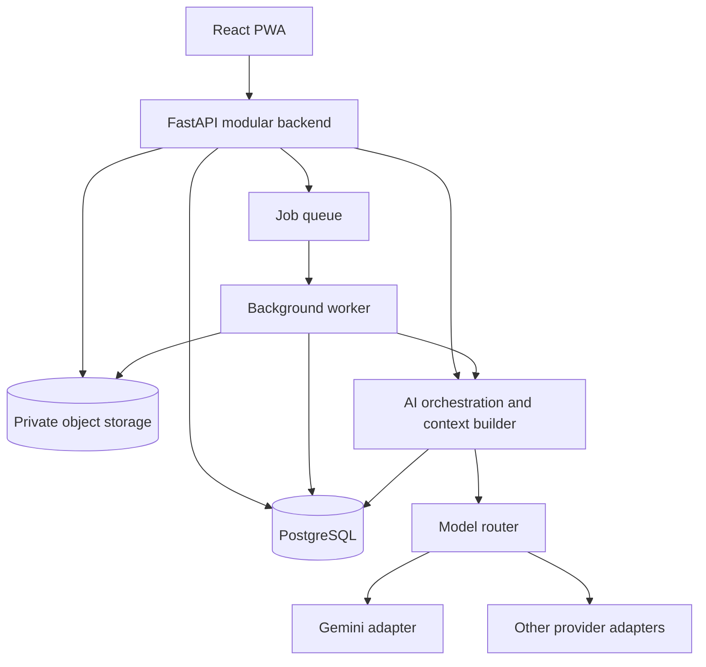

# AI Work Tracker SaaS — Codex Engineering Handoff

**Document version:** 1.0  
**Prepared:** 25 October 2026  
**Status:** Build-ready engineering handoff; unresolved operational decisions are identified explicitly  
**Source of truth for product intent:** [AI Work Tracker SaaS PRD v1.2](https://chatgpt.com/space/page_cf316b4bc7488191a10d370d065fcb0b)  
**Target:** Multi-user, private-workspace, invitation-only beta with hybrid AI access and model-agnostic continuity.

> **Purpose.** This handoff is designed to be placed at the root of a new Codex project. It translates the product PRD into an implementable architecture, data/API contracts, user journeys, release sequence, acceptance tests, and a master Codex kickoff prompt. Where a vendor, deployment region, price, quota, or other business decision is not yet locked, an explicitly labelled engineering default is proposed rather than presented as a signed-off requirement.

## 0. How to use this handoff with Codex

1. Create a new private repository, preferably named `ai-work-tracker` until the brand is finalised.
2. Add this file at the repository root without changing its name. Keep the PRD link above in the repository README.
3. Open the repository in Codex and paste the **Master Codex kickoff prompt** in Section 19. Tell Codex to read this document before touching code.
4. Have Codex implement the first *vertical slice* only: invite/auth gate, private workspace, manual task creation/update, append-only task events, and Kanban rendering. The app must run and its tests must pass before moving to AI.
5. Review each milestone against the gate criteria in Section 16. Merge one verified milestone at a time. Never ask Codex to fabricate API keys, enable paid resources, publish the beta, or bypass tenant/privacy controls.
6. Keep `docs/decisions/` for architecture decision records (ADRs), `docs/progress.md` for implemented functionality, and `docs/open-decisions.md` for unconfirmed product choices.

**Priority conventions:** `P0` = required for the first usable closed-beta foundation; `P1` = required for the fuller intended beta experience, but can follow P0. Provider-specific features must be behind capability flags rather than assumed to work identically everywhere.

## 1. Product definition and non-negotiable decisions

### 1.1 Product in one paragraph

The application is an AI-assisted personal work tracker. An individual user can paste an office email, type a request, or upload a screenshot/PDF/DOCX. An LLM extracts and refines one or more task proposals, optionally suggesting steps and deliverables. The user reviews and approves those proposals. Tasks are persistent, editable through cards or contextual chat, shown on a Kanban board and a Teams-like calendar view, linked to relevant annual goals with human approval, and exportable as a clean Excel work/activity record for any inclusive date range. Reminders are delivered in-app and by web push where supported. Users may configure multiple AI vendors, switch providers with consent, and continue a conversation without losing the application's authoritative workspace history.

### 1.2 Locked product decisions

| Topic | Binding requirement |
| --- | --- |
| Audience | Multi-user SaaS, invitation-based free beta. |
| Workspace | Each user owns a **private** workspace. No shared boards or team membership UI in MVP. Preserve a future membership-compatible schema. |
| Email intake | **Manual paste/upload only**. No automatic Gmail/Outlook sync or mailbox permissions in MVP. |
| Input | Typed chat, pasted email, PNG/JPEG screenshots, PDF and DOCX. |
| AI access | **Hybrid**: platform-managed trial credits and user-supplied API keys (BYOK). |
| Initial provider adapter targets | Google Gemini, xAI Grok, Mistral, OpenAI and Anthropic Claude. Grok is not Groq. |
| Switching | Ask approval before each cross-provider switch by default; optional explicit and revocable consent for a named, ranked fallback chain. |
| Memory | Full conversation and workspace records belong to the SaaS, not a vendor conversation ID. The next model receives a bounded, relevant context packet. |
| Mutations | AI may interpret and suggest. Authoritative task/goal changes require user approval and a validated application transaction. Direct manual UI edits are intentional user actions. |
| Task views | Today dashboard, Kanban, task details/activity history, day/week/month calendar. |
| Goals | Annual/custom-period goals; task-to-goal mapping suggested by AI and approved by the user. |
| Reporting | XLSX for a custom inclusive date range, including **activities on older tasks**, not only tasks created during that period. |
| Mobile | Responsive PWA, in-app reminders, and best-effort permissioned web push where supported. |
| Privacy | Per-workspace isolation in every API, query, file, queue job, AI context, report and cache. BYOK secrets server-side only. |

### 1.3 Out of scope for beta

- Shared team boards, manager dashboards across other users, delegation, and workspace collaboration.
- Native mobile applications, automatic mailbox ingestion, email sending, Outlook/Teams calendar synchronization.
- Fully autonomous execution of office work, sending external messages, or unapproved AI database mutations.
- Subscription checkout, enterprise billing, unrestricted model/plugin marketplaces, and training models on user uploads.
- A Kubernetes/microservices deployment solely for an invitation beta. Keep the backend modular so services can be separated later if measurements justify it.

### 1.4 Product promises that must remain honest

1. **Stored memory is not infinite model context.** The platform retains authorised records, but no promise is made that every historical message and file is sent to every model on every turn.
2. **Provider caches are not portable memory.** A new model is rehydrated from application records. Cache hits are optional and separately measured.
3. **Estimated AI costs are not guaranteed invoices.** Show assumptions and actual metered usage separately.
4. **A reminder is best-effort.** Browser push may be unavailable, unsupported, declined, or delayed. In-app notifications remain available.
5. **Task-to-goal relevance is not achievement.** Completing related tasks does not automatically mark a yearly objective achieved.

## 2. Recommended implementation architecture

This section is an **implementation default**, not a locked vendor procurement decision. Use a **modular monolith** for beta: one versioned API codebase, a separate background worker process, one PostgreSQL data store, and private object storage. This minimises integration work while preserving clearly separated domains.

| Layer | Recommended default | Notes |
| --- | --- | --- |
| Web client | React + TypeScript + Vite | Router, typed API client, accessible component primitives, responsive PWA shell. |
| Backend | Python FastAPI | Versioned REST endpoints, SSE for AI streaming, Pydantic validation, domain services. |
| Persistence | PostgreSQL + SQLAlchemy + Alembic | Typed relational schema, transactions, indexes, optional row-level security defence in depth. |
| Jobs | Redis-backed worker/queue (Celery, RQ or equivalent) | File extraction, summarisation, reminders, XLSX builds, retention cleanup. Select and document one implementation. |
| Object storage | Private S3-compatible buckets | Uploaded originals, derived assets and expiring XLSX exports. No public bucket objects. |
| Search | PostgreSQL full-text search first; optional pgvector | Add semantic retrieval only after basic task/source search works and tenancy tests exist. |
| AI | Provider-neutral router + provider adapters | Gemini, xAI, Mistral, OpenAI, Anthropic; capability-based routing, bounded timeouts. |
| XLSX | Python openpyxl or equivalent | Database-driven, deterministic Excel export; **no LLM required**. |
| Authentication | Reputable managed OIDC/email identity provider (final selection pending) | Backend verifies identity; beta invite and workspace creation are application-owned. Never ship a mock login. |
| Hosting | Docker-based API/worker; static frontend; managed DB/object storage | Choose vendor/region after workplace-data privacy and residency review. |
| Observability | Structured metrics, traces and content-redacted logs | Usage/latency/error labels, no user email text or raw API keys. |

### 2.1 System topology



**Hard boundary:** provider adapters never own task state or determine workspace authorisation. Only backend domain services can write tasks/events. No client-side SDK calls using personal or platform AI keys.

### 2.2 Bounded contexts / modules

1. **Identity and tenancy:** invitation redemption, user verification, session identity, private workspace access.
2. **Task domain:** tasks, steps, deliverables, notes, event journal, status transition rules.
3. **Capture and files:** upload intake, safe parsing, OCR/vision abstraction, source provenance.
4. **Conversations and proposals:** messages, task-scoped chats, structured AI suggestions, approvals.
5. **Goals:** year/period goals, milestones, suggested and accepted task links.
6. **Calendar and reminders:** derived task calendar, notification rules, push registrations and job reconciliation.
7. **Reports:** point-in-time query/export jobs and formatted XLSX generation.
8. **AI platform:** credential vault, usage ledger, context retrieval, provider routing, failover/checkpoints, token optimisation.
9. **Beta operations:** invites, entitlements, redacted service health, admin audit.

### 2.3 Suggested repository layout

```text
ai-work-tracker/
  AI_Work_Tracker_Codex_Build_Handoff.md
  README.md
  AGENTS.md                         # created by Codex from engineering rules here
  .env.example                     # placeholders only
  compose.yaml                     # local DB/Redis/object-store dev services
  apps/
    web/
      src/
        app/ routes/ components/ features/
        api/ hooks/ lib/ styles/
      public/
      tests/
  services/
    api/
      app/
        main.py
        core/                     # config, identity, tenant context, errors
        db/                       # engine, migrations, models
        domains/
          identity/ tasks/ sources/ conversations/ goals/
          reports/ notifications/ ai/ admin/
        api/v1/
        schemas/
      alembic/
      tests/
    worker/
      jobs/                       # extraction, reminder, export, cleanup
      tests/
  packages/
    contracts/                    # OpenAPI and generated TypeScript client
  docs/
    decisions/ progress.md open-decisions.md
  tests/
    e2e/ fixtures/ security/ai/
  scripts/
    seed_demo_data.py
    verify_local_setup.sh
```

**Code standards:** Python typing, Pydantic request/response models, explicit migrations, typed TypeScript, format/lint/type checks, readable service boundaries, isolated integration tests, and deterministic fake AI providers for CI. Add an ADR for changes to the core architecture.

## 3. User roles, authentication and tenant isolation

### 3.1 Roles

- **Workspace owner:** one per private workspace in MVP; full authority over their own records, keys, settings and exports.
- **Beta operator:** can manage invites, account state, credit entitlements and aggregate operational diagnostics; **cannot ordinarily browse private tasks, files, conversations or reports**.
- **Background worker:** scoped service identity acting on an authorised workspace job; must re-check account/resource state before effects.

### 3.2 Required authorisation design

- Resolve `current_user` from a verified server-side auth session/token. Derive `workspace_id` from an authorised membership; never trust a caller-supplied workspace ID.
- Every owned entity has `workspace_id`, or must be joined to an owned parent with equivalent enforcement. Prefer composite constraints to prevent cross-workspace foreign-key references.
- Scope reads, writes, exports, retrieval, signed URLs, notification jobs, websocket/SSE channels, vector searches, derived summaries, admin diagnostics and cache keys.
- Use PostgreSQL row-level security as **defence in depth** where configured; it is not a substitute for application-level authorisation. Avoid database superuser/bypass roles in normal API traffic.
- The `workspace_memberships` table is future-ready, but only owner membership is creatable in beta.
- API errors for a foreign object should not reveal that another user's record exists (typically `404` or a deliberately uniform permission response).
- Use a one-time transactional invite redemption path, plus rate limiting and credential/session revocation support.

### 3.3 First milestone authentication path

Codex must propose and record an auth-provider ADR before implementing production auth. An offline development/test identity fixture is permitted **only in tests/local-only builds** and cannot be enabled in beta production. Do not use a fake login screen that simply trusts a selected user ID.

## 4. Domain data model

Use UUID primary keys, `created_at` and `updated_at` in UTC where applicable, and an indexed `workspace_id` on every workspace-owned table. Keep presentation dates and timezone names separate from authoritative UTC instants. The names below are contract targets, not a claim that migrations already exist.

### 4.1 Identity, tenancy and settings

| Table | Important fields and constraints |
| --- | --- |
| `users` | `id`, verified unique email, auth subject, display name, IANA timezone, account status. |
| `beta_invites` | `id`, token **hash**, email restriction/allowlist, `expires_at`, `redeemed_at`, max uses and creator. |
| `workspaces` | `id`, `owner_user_id`, name, state, retention settings, created timestamp. |
| `workspace_memberships` | `workspace_id`, `user_id`, role; unique pair; beta service admits only owners. |
| `workspace_preferences` | Week start, timezone override, notification settings, report defaults, selected AI mode, privacy flags. |

### 4.2 Tasks and their audit history

| Table | Important fields and constraints |
| --- | --- |
| `tasks` | `id`, `workspace_id`, title, summary, description, `status`, priority, optional category, `start_at`, `due_at`, `completed_at`, `archived_at`, progress mode, manual progress, version integer, source reference. |
| `task_steps` | `task_id`, text, order, checked state, checked time, optional assignee label (non-collaborative). |
| `deliverables` | `task_id`, description, state, optional evidence asset reference. |
| `task_notes` | `task_id`, author, content, timestamps; provenance of manual/approved-AI origin. |
| `task_events` | Append-only `id`, task, workspace, actor, event kind, occurred_at, field before/after JSON, source, correlation ID, note. Unique idempotency/correlation for mutations. |
| `source_assets` | `id`, workspace, kind, filename, MIME, byte size, private object key, extraction state, text hash, retention expiry; separate extracted text/chunks if useful. |

**Task status enum:** `inbox`, `planned`, `in_progress`, `waiting`, `blocked`, `in_review`, `completed`, `cancelled`. The Board prominently shows the first seven. `cancelled` and archived tasks are accessible by filter/report but do not occupy a default Board column.

**State semantics:** Completion records a timestamp and event. Reopening preserves that prior event, changes current status and records another event. Manual progress and step-derived progress are labelled; completing a step never silently rewrites manual progress unless explicitly designed and accepted.

### 4.3 Conversations, AI proposals and memory

| Table | Important fields and constraints |
| --- | --- |
| `conversations` | Workspace, title, owner, last activity time, optional selected task. |
| `messages` | Conversation, ordered sequence, role, content, optional task, message status (`sent`, `interrupted`, etc.), source refs and provider provenance. |
| `ai_proposals` | Conversation, kind, proposed JSON, source evidence, review state, reviewed-by, idempotency key, approved commit reference. |
| `conversation_memory_summaries` | Conversation, covered revision range, summary, evidence IDs, source version and summariser model; derived, not authoritative. |
| `context_manifests` | AI run, target model, task/goal/message/source IDs included, estimated tokens, excluded categories and generated revision. |
| `search_chunks` | Source/task pointer, workspace, chunk text/hash, extraction version; embeddings optional and always tenant-scoped. |

### 4.4 Goals, reports and reminders

| Table | Important fields and constraints |
| --- | --- |
| `goals` | Workspace, title, description, explicit period start/end, success criteria, state, progress mode. |
| `goal_milestones` | Goal, description, target/actual measures, status, achieved timestamp and evidence. |
| `task_goal_links` | Task, goal, suggestion rationale, origin, review state, timestamp; unique task-goal pair. |
| `reminder_rules` | Task, channel, deadline offset, enabled, quiet-hours override. |
| `notification_jobs` | Task, next fire timestamp, status, attempts, unique dedupe key; invalidated on completion/reschedule. |
| `notification_endpoints` | User, protected web push endpoint/subscription, device label, permission/revocation state. |
| `notifications` | User, workspace, optional task link, kind, payload preview, read and delivery timestamps. |
| `export_jobs` | Workspace, report basis, inclusive local dates, timezone, filter snapshot, cutoff time, state, private output key, expiry, error metadata. |

### 4.5 Hybrid AI, credentials, metering and failover

| Table | Important fields and constraints |
| --- | --- |
| `ai_credentials` | Workspace, provider, encrypted secret/reference, masked fingerprint, validation state, rotation/revocation timestamps. |
| `ai_provider_configs` | Workspace, provider/model, enabled, capability snapshot, primary/fallback preference. |
| `beta_entitlements` | Workspace, platform-credit allowance, consumption, reset policy, fair-use quota, status. |
| `ai_usage_events` | Unique request ID, workspace, model/provider, token categories, cached tokens, actual or estimated cost, billing mode, status and timing. No prompt text. |
| `provider_health_states` | Provider/model scope, error category, cooldown, sampled time; prefer passive signals over paid polling. |
| `failover_policies` | Workspace, `approval_each_switch` or `preapproved_chain`, ordered models, consent versions, platform-credit permission, revocation timestamp. |
| `agent_run_checkpoints` | Conversation/run ID, revision, selected task, original request, pending proposals, committed operation IDs, idempotency keys and state. |
| `model_handover_offers` | Run, destination, manifest/revision, input/output estimates, cost range, pricing version/currency/billing mode, expiry and status. |
| `model_switch_approvals` | Offer/run, approving actor, selected provider/model, allowed data categories, mode, grant/expiry/revocation timestamps. |
| `ai_failover_events` | Run, source/destination providers, error category, approval reference, context manifest reference, outcome and timestamp. |

### 4.6 Constraints and indexes

- Unique `(workspace_id, task_id, goal_id)` conceptually enforced for mappings (using actual link IDs as appropriate).
- Index tasks `(workspace_id, status, due_at)`; events `(workspace_id, occurred_at, task_id)`; messages `(workspace_id, conversation_id, sequence)`; notification jobs `(state, fire_at)`.
- Unique idempotency keys per owner/operation where expected; unique invite redemption and notification delivery dedupe keys.
- All event mutations (task update **plus** corresponding event row) commit in one DB transaction. Optimistic task version checks return a conflict and never silently overwrite another tab's edit.
- Retention cleanup includes raw files, extracted text, embeddings, memory summaries, queued jobs, derived exports and provider references as permitted by policy.
- Migrations must be reversible where safe; irreversible purges need explicit operational review.

## 5. User interface and route-by-route UX contract

**Design direction:** Calm, high-contrast, professional. Desktop: left navigation rail; central page; contextual AI rail that can open with a selected task. Mobile: responsive bottom navigation/overflow, full-screen assistant and task sheets. Reuse one task-card component across Today/Board/Calendar, one details drawer, and visible selected-task context chips.

| Screen | Route | Minimum components and actions | Essential acceptance |
| --- | --- | --- | --- |
| S01 Invitation/registration | `/join/:invite` | Token status, signup, verification, expired/redeemed errors. | Redeem once; create exactly one owner/workspace; reject bad invites. |
| S02 Sign-in/recovery | `/auth`, `/recover` | Provider sign-in and account recovery. | Protected routes, safe recovery messages, expiring reset flow. |
| S03 Onboarding | `/onboarding` | Timezone/week start, sample task, AI mode, notification preference. | Manual tracker usable even if no AI key/credit. |
| S04 Today | `/app/today` | Due soon, overdue, blocked, in progress, recently updated, quick capture, goals. | Metrics reconcile to the same task query and timezone as Board. |
| S05 Assistant | `/app/assistant` | Conversation list, composer, attachments, source snippets, task chip, model badge, proposal review. | Durable chat; failed streams labelled; no task before approval. |
| S06 Kanban | `/app/board` | Seven status columns, filters/search, drag/drop, cards, add task. | Drag updates authoritative state/event; failed drag rolls back. |
| S07 Calendar | `/app/calendar` | Day/week/month, due task cards, status filter, rescheduling. | Correct local date; undated tasks not assigned fake dates; no false Outlook sync claim. |
| S08 Task details | `/app/tasks/:id` | Fields, steps, deliverables, evidence, notes, goal links, blockers, full events, Ask AI. | Timeline is traceable; archive/reopen preserves history; deep links authorised. |
| S09 Goals | `/app/goals`, `/app/goals/:id` | Goal period selector, milestones, imports, matching suggestions. | Suggestions reviewed; many-to-many; no automatic achievement. |
| S10 Reports | `/app/reports` | Inclusive range, basis, filters, preview, queued export and history. | Five-sheet Excel; event-based inclusion works; private download. |
| S11 Notifications | `/app/notifications` | Read/unread alerts, task links, push status and preferences. | No stale reminders after deadline/status changes. |
| S12 Settings | `/app/settings` | Profile, timezone, Security, AI Providers, Model Continuity, Usage & Credits, Reminders, Privacy & Data. | Key never displayed plaintext; consent revocable; limits enforced server-side. |
| S13 Beta ops | `/admin` | Invites, cohort, aggregate usage/health and quota controls. | Role-gated; no routine access to user content. |

### 5.1 Global handover approval modal

**Trigger:** A run is safely paused after qualifying quota/rate-limit/busy/timeout/capability errors and bounded retries. On desktop present a focused dialog; on mobile a full-width accessible sheet.

**Required sections:**

1. **What happened:** failed model, readable reason, saved draft/run state.
2. **Proposed replacement:** ranked eligible model choices, health and vision/tool/structured-output capabilities.
3. **Projected additional usage:** input/output token estimate, estimated amount/range and currency, payer (BYOK provider charge versus platform credits), remaining allowance, cost uncertainty. The previously failed attempt's charges are **not** quietly folded into or omitted from the explanation.
4. **Permissions:** destination processor, privacy notice and exact categories to transfer (prompt, selected task, recent messages, summaries, goals, excerpts, optional attachments). An unapproved processor requires affirmative consent; no data transfer while pending.
5. **What will resume:** committed actions, interrupted reply, pending task-update proposals, next unresolved operation and any context excluded for budget/capability reasons.
6. **Actions:** Approve and continue with selected model; choose another; retry original if safe; not now; separate configuration of a standing approved chain.

**Offer semantics:** A short-lived server-generated offer binds run/checkpoint revision, target model, price version, context manifest, billing mode and permitted data categories. On approval revalidate policy, key health, tenant ownership, cost cap, source revision and idempotency. If stale, regenerate offer and require new confirmation. If estimate is unavailable, explicitly say so—never show zero as if free. A one-time grant does not grant standing consent.

**Recovery:** Already committed database actions are not replayed. A partial model response is marked interrupted and a new response is generated from the unresolved request and application-owned context. If all models are unavailable, keep manual task functionality working. Post-switch banner identifies target model, scope and audit record.

### 5.2 Reusable UI states

- Loading, empty, no-results, validation error, network loss, unauthorised/forbidden, retryable failure, non-retryable failure and successful save.
- AI run states: Queued → Reading → Analysing → Proposal ready, or Failed / Awaiting switch approval / Resuming / Completed.
- Keyboard access, visible focus, screen-reader labels, high contrast and mobile responsive behaviour are release requirements.
- Never render an unapproved AI proposal as if it were a saved task.

## 6. Important workflows and business logic

### 6.1 Pasted email or screenshot to approved task

1. User pastes text or uploads an authorised file; file validation checks MIME/signature, size, malware policy and owner.
2. Store the original in private storage; extract text once, preserving provenance, source IDs and meaningful sender/date/quoted-trail information. OCR may be used for images, but reuse extracted text later.
3. AI extraction returns **zero, one or many** independent task candidates with evidence and uncertainty; the server validates a strict JSON schema.
4. Show each candidate for **edit / approve / reject**, with optional steps and deliverables. Ambiguous relative due dates are clarified in the user's timezone.
5. Approved candidates commit with unique idempotency keys and events. Repeated clicks/requests do not duplicate tasks.
6. Show approved task in Today/Board/Calendar and optionally suggest a goal link; goal link remains pending review.

### 6.2 Contextual assistance and task update

1. User selects **Ask AI** on a task card; the assistant shows a visible selected-task chip.
2. Backend retrieves **only** authorised, relevant task, step, event, source and recent conversation context.
3. Asking for advice generates **guidance**, not a mutation.
4. A message such as “I finished the SQL query part; move deadline to Friday” produces a **proposed update** with before/after fields and a clarification if Friday is ambiguous.
5. User reviews and approves; server rechecks task version and commits update plus event atomically.

### 6.3 Goal creation and mapping

1. User defines goals by form/chat/upload, chooses explicit period and success criteria; every extracted goal is reviewed.
2. Relevant task creation/update may generate a suggested link only to goals in the current user workspace/eligible period.
3. Suggestion includes rationale/confidence/evidence; user can accept, reject, or manually link multiple goals.
4. Goal achievement/progress is separately entered or confirmed; a related task does not automatically prove the entire goal achieved.

### 6.4 Monthly work report

1. User selects inclusive start/end local dates, timezone, report basis (Created / Completed / Activity / Active during period) and filters.
2. Server converts selected dates into a timezone-aware half-open UTC interval: `[start local midnight, next-day-after-end local midnight)`.
3. Snapshot eligible data for consistent workbook sheets. For **Activity**, include a task created in October if it has November events; Task Register lists it once, Activity Timeline lists each qualifying November event.
4. Queue workbook job, generate deterministic XLSX, make a short-lived private download and preserve export job metadata.

### 6.5 Deadline reminders

1. A task's due time, reminder offsets and quiet hours determine scheduled jobs in the user's timezone.
2. Status changes to completed/cancelled, archived tasks, or reschedules invalidate/reconcile future jobs with dedupe keys.
3. In-app notice is authoritative UI fallback; web push is optional and permission-based, without leaking confidential task content to device lock screens by default.

### 6.6 Safe AI provider failover

1. Before calling the model, persist an AI run checkpoint, user request, chosen task IDs, pending proposals, committed operation IDs and versioned context manifest.
2. On provider error, classify `rate_limited`, `quota_or_spend_exhausted`, `busy_or_overloaded`, `timeout_or_network`, `authentication_invalid`, `context_window_exceeded`, `unsupported_capability`, `policy_blocked` or `unknown`.
3. Apply bounded backoff only where safe; respect retry-after/cooldowns. Never loop indefinitely on spend/quota/auth failures.
4. Select only models with valid credentials/credits, consent, capabilities, context capacity and health eligibility.
5. If approval-each-switch is active, show the handover modal. If a specific named chain was preapproved and is still valid, switch only within that chain and notify/audit.
6. Context Builder reconstructs context from canonical messages, workspace facts, summaries and relevant source excerpts—not private previous-model chain-of-thought.
7. Resume unresolved work; do not replay committed mutations; label interrupted partial output; persist provenance of the resulting answer.

## 7. AI orchestration, token control and prompt contracts

### 7.1 Provider-independent orchestration

Design one internal interface with independent adapters; each adapter maps standard request/response structures to vendor APIs and normalises usage/error/tool-result semantics. Suggested internal operations:

```python
class AIProviderAdapter(Protocol):
    async def complete(self, request: "ModelRequest") -> "ModelResponse": ...
    async def stream(self, request: "ModelRequest") -> AsyncIterator["ModelEvent"]: ...
    def capabilities(self, model_id: str) -> "ModelCapabilities": ...
    def classify_error(self, error: Exception) -> "ProviderError": ...
```

`ModelRequest` should include `run_id`, a canonical message list, bounded `context_manifest`, selected provider/model, required capability flags, output budget, timeout and allowed tool descriptions. `ModelResponse` should include validated output, provider/model, usage breakdown (input/output/cached/reasoning if available), finish reason, latency and request reference. Avoid logging raw prompts/keys in usage telemetry.

**Provider metadata is configurable**, not hardcoded into task/domain logic: model capability flags, supported modalities, structured-output support, context limit, token counting strategy, current pricing, timeout/retry patterns and vendor data-processing notices. BYOK keys must be encrypted server-side and revoked keys immediately excluded.

### 7.2 Task routing rules

| Operation | Preferred method | Reason |
| --- | --- | --- |
| Drag Kanban card, edit date from picker, calculate progress, export Excel, schedule reminder | Deterministic app code | Zero LLM tokens. |
| Simple intent to mark task done | Small supported model if natural-language parsing is necessary | Low-cost structured intent + user confirmation. |
| Extract tasks from email | Economical extraction-capable model | Strict schema; improve only on uncertainty/failure. |
| Match task to goals | Simple search/rules first; AI only for uncertain candidates | Avoid broad repeated full-workspace prompts. |
| Help with a difficult technical step | Capable reasoning model | Retrieve relevant task/context, allow explicit escalation. |
| Large source/document analysis | Text extraction + selective retrieval + capable model | Avoid repeated vision/full document upload. |

### 7.3 Context Builder contract

The context packet consists, in order, of:

1. Stable application instructions and tool safety rules.
2. The current, exact user request and explicit selected task reference.
3. Latest *authoritative* task/goal state and any committed operations needed for this turn.
4. Short, versioned conversation summary plus a bounded number of recent turns.
5. Relevant older messages/events/doc excerpts retrieved by keyword and (later) semantic search, with source IDs.
6. Expected output schema and token/output caps.

**Selection rules:** Always respect tenant boundary and data retention. Select by task ID first when one is attached; then relevant events, goal links and source pointers. Use top-k retrieval with relevance thresholds and token-budget packing. Preserve full originals in storage, not in every prompt. Never claim missing data is absent from the workspace merely because it was omitted from the current context packet.

### 7.4 Token/cost optimisations required early

- Classify no-AI operations before any LLM call.
- OCR/parse uploads once; cache extracted **application data** with content hashes and provenance.
- Summarise conversations periodically at meaningful boundaries and version summaries; never let a summary overwrite original messages/events.
- Use economical capable models for extraction, reserve expensive reasoning for complex guidance, and allow user-controlled quality preference later.
- Keep prompts compact, stable sections first for provider caching, mutable per-turn fields later; track actual cache hits and billing when the vendor exposes them.
- Impose input/output token caps and per-workspace trial budgets; enforce on the server. Cost estimator must be conservative about output range and retry/caching uncertainty.
- On retry/failover, reuse stored extraction and checkpoint data rather than reprocessing documents or repeating committed steps.
- Meter *cost per completed user action*, first-attempt success, average input/output tokens, provider cache rate, latency, failed attempt cost and handover success.
- Guard against unnecessary chains of LLM calls; keep simple workflows as deterministic multi-step functions.

### 7.5 Strict extraction output shape (illustrative)

```json
{
  "intent": "create_task",
  "task_candidates": [
    {
      "title": "Prepare Java and SQL hiring assessment",
      "summary": "Create case study, solution and test cases",
      "explicit_due_at": null,
      "due_date_uncertain": true,
      "priority": null,
      "status": "inbox",
      "deliverables": ["Case study", "Solution", "Test cases"],
      "optional_steps": ["Define requirements", "Draft tasks", "Review tests"],
      "questions": ["Which Friday is the intended deadline?"],
      "evidence_spans": [
        {"source_asset_id": "source-reference", "quote": "Please prepare the assessment by Friday"}
      ]
    }
  ]
}
```

The server generates proposal IDs, workspace/user IDs and timestamps. It validates field lengths/enums/dates and sanitises evidence. Never allow the model to create authoritative IDs, choose a different workspace, call unrestricted tools, or interpret text inside an uploaded email as a system instruction.

### 7.6 Proposal and run state machines

```text
AI proposal: draft -> ready_for_review -> approved | rejected | expired
AI run: queued -> preparing_context -> calling_model -> streaming -> completed
                 | awaiting_approval -> resuming -> completed
                 | interrupted | failed | cancelled
Export: queued -> running -> ready | failed | expired
```

Use valid transition checks. A proposal is **not** an actual task until its approval transaction commits. A failed/duplicate approval returns the existing commit result where possible, never a second task.

### 7.7 User-facing response rules

- Identify the provider/model that generated an AI answer in an unobtrusive badge and model history.
- If source evidence is relevant, show the original asset name/source excerpt and source pointer.
- For ambiguous dates, responsibilities, or unstated priorities, ask clarification or show a null field; don't invent.
- On switches, display that the response continues from saved workspace information, not an identical transfer of model-private state.
- Keep data-affecting proposals visually separate from ordinary assistant text and request explicit review.

## 8. API contract (versioned REST + streaming)

Prefix: `/api/v1`. Use OpenAPI generated by FastAPI as the machine-readable API specification, generate a typed frontend client from it, and keep error types consistent. Identity endpoints depend on the selected managed auth solution. All routes require authenticated workspace context unless specifically public/invite related.

| Resource | Minimum endpoints | Important semantics |
| --- | --- | --- |
| Workspace/profile | `GET /me`, `GET /workspace`, `PATCH /workspace/preferences` | Server-derived current workspace; timezone/preferences. |
| Tasks | `GET /tasks`, `POST /tasks`, `GET /tasks/{id}`, `PATCH /tasks/{id}`, `POST /tasks/{id}/archive`, `/restore` | Version check, filter/sort/pagination, audit event transaction. |
| Steps/notes/events | `POST/PATCH /tasks/{id}/steps`, `POST /tasks/{id}/notes`, `GET /tasks/{id}/events` | Ordered, immutable events; step completion explicit. |
| File intake | `POST /assets/presign`, `POST /assets/{id}/complete`, `GET /assets/{id}/download` | Short-lived grants, private bucket, scan status. |
| Conversations | `GET/POST /conversations`, `GET /conversations/{id}/messages`, `POST /conversations/{id}/runs` | Task-scoped context, saved pending user message. |
| AI streaming | `GET /ai/runs/{id}/events` (SSE or equivalent) | Progress, partial text, proposal ready, failure, final usage. |
| Proposal review | `GET /ai/proposals/{id}`, `POST /ai/proposals/{id}/decision` | Approve/edit/reject with idempotency and version. |
| Goals | `GET/POST /goals`, `PATCH /goals/{id}`, `POST /goals/{id}/milestones`, `POST /goal-links/{id}/decision` | Review suggested links, separate achievement tracking. |
| Calendar | `GET /calendar?from=&to=` | Derived from task due dates; timezone and permission. |
| Reports | `POST /exports`, `GET /exports/{id}`, `GET /exports/{id}/download` | Snapshot, queue and expiring protected link. |
| Notifications | `GET /notifications`, `PATCH /notifications/{id}`, `POST /push/endpoints`, `PUT /reminder-preferences` | Quiet hours, device owner, dedupe. |
| AI preference/key | `GET/PATCH /ai/preferences`, `POST /ai/credentials/test`, `PUT/DELETE /ai/credentials`, `GET /ai/usage` | Never return secret plaintext. |
| Provider routing | `GET /ai/providers/eligible`, `PUT /ai/failover-policy`, `POST /ai/runs/{id}/recover` | Capability checks, consent and errors. |
| Handover | `GET /ai/runs/{id}/handover-offer?target_model=`, `POST /ai/runs/{id}/approve-switch`, `GET /ai/runs/{id}/handoff` | Quote/consent/checkpoint tied to same run; no external call before approval. |
| Model history | `GET /conversations/{id}/model-history` | Auditable, content-redacted provider transition history. |
| Beta admin | `POST /admin/invites`, `PATCH /admin/entitlements/{id}`, `GET /admin/health` | Strict beta-operator role; metadata only. |

### 8.1 Example task update request and response

```http
PATCH /api/v1/tasks/{task_id}
Authorization: Bearer <session token>
Idempotency-Key: <client-generated uuid>
Content-Type: application/json

{
  "expected_version": 4,
  "changes": {
    "status": "in_progress",
    "due_at": "2026-10-30T12:00:00Z"
  }
}
```

```json
{
  "task": {"id": "<uuid>", "version": 5, "status": "in_progress"},
  "event": {"id": "<uuid>", "event_type": "task_updated", "occurred_at": "<UTC ISO timestamp>"}
}
```

**Error format:** `{ "error": { "code": "version_conflict", "message": "This task changed in another session.", "retryable": false, "correlation_id": "..." } }`. Do not leak SQL traces, private source text, credentials, provider headers or foreign record IDs.

### 8.2 Streaming event examples

Use typed events such as `run.queued`, `run.reading_source`, `run.context_ready`, `run.model_started`, `run.delta`, `proposal.ready`, `run.interrupted`, `run.awaiting_switch_approval`, `run.resuming`, `run.completed`, `run.failed`. Every event includes `run_id`, monotonic sequence, timestamp and sanitised payload. Clients must recover by fetching durable run state if a stream disconnects.

## 9. Report and Excel workbook specification

**Five required sheets:**

1. **Summary** — inclusive period, basis, filters, generation time, counts by status and completion/overdue breakdown.
2. **Task Register** — unique task per inclusion rule, identifiers, title, description, status/priority, dates, progress, steps/deliverables, blockers, goals and source type.
3. **Activity Timeline** — each eligible event with task ID/title, exact timestamp, actor, action, before/after, note and reference.
4. **Goal Contributions** — goal period, approved task links, milestones, outcome and evidence.
5. **Outstanding Work** — incomplete, waiting, blocked and overdue items, next action and due-date information.

Formatting: readable navy/blue-and-white professional style (changeable branding), frozen headers, filters, wrapped descriptions, practical widths, Excel-friendly date values with clearly labelled timezone, status colour coding, print-friendly summary, no formulas that need macros. Do not include raw email bodies or attachment contents without a future explicit export choice.

**Canonical reporting test:** A task created 14 October and updated 5 November appears in a 1–30 November **Activity** report: one Task Register row, the 5 November event in Activity Timeline, and its true 14 October creation date. The same task should not incorrectly appear in a November **Created** report.

## 10. Security, privacy and responsible AI requirements

| Control | Acceptance/security test |
| --- | --- |
| Tenant isolation | User A cannot read/mutate User B task IDs, assets, goals, conversation messages, exports, embeddings or AI context, even with guessed URLs/IDs. |
| Authentication | Protected endpoints require verifiable auth; invite tokens hashed, expiring and one-use. |
| Secret management | Provider keys encrypted with protected server-side key management; API shows masked status only; never log plaintext or expose browser-side. |
| Data protection | TLS, private object storage, expiring download grants, explicit retention and deletion including derived data. |
| Upload safety | File signature/MIME/size checks, malware scan or appropriate safe handling, parsing limits/timeouts, rejection reasons. |
| Prompt injection | Emails/screenshots/documents are untrusted **data**. Their contents cannot override system rules, tools or tenant policy. |
| Human review | Every AI-proposed data mutation is separately reviewed; one approval commits once. |
| Failover consent | No request to a new provider before one-time/standing approval authorises its data categories; revocation takes effect for subsequent runs. |
| Recovery correctness | Crash after DB commit but before response, retry after 429/timeout and double-click approval do not duplicate task/events. |
| Cost enforcement | Hard platform-credit and BYOK safety caps on server; unavailable handover estimate never displayed as free. |
| Logging | Correlation/request IDs, timings, error codes and token usage; no unredacted office email text, screenshots, documents or keys in logs/traces. |
| Admin limitation | Beta operator sees aggregate usage and technical health, not general personal workspace contents. |
| Backup/recovery | Test real restore and retention/purge workflows before external beta. |
| Accessibility | Keyboard-first and screen-reader modal/board/calendar usability; target WCAG 2.2 AA. |

**Office-data caution:** Before admitting real corporate emails or sensitive attachments, decide geographic processing, vendor data handling, consent wording, retention and deletion policy. Engineering mocks/sample data are not approval to process an employer's confidential records.

## 11. Operational non-functional targets

- Default Board/Calendar API target: p95 less than approximately 2 seconds under an agreed beta-sized test fixture, measured rather than asserted.
- AI calls execute asynchronously or stream progress; UI must remain interactive during slow providers.
- Bounded retries with jitter and circuit breakers; expose meaningful status, never infinite retry storms.
- Budget limits: per-run input/output tokens, daily/monthly user caps, concurrency/rate limits and admin trial entitlements.
- Use server-side observability for provider errors, request success, retrieval relevance, cache hit rates and cost per completed action.
- Beta admin has a redacted diagnostic dashboard and support incident correlation IDs.
- Local setup should start with one documented command for DB/queue dependencies and separate clearly documented web/API/worker dev commands.
- Every deploy includes automated migration check and a rollback/backup plan; do not auto-run destructive migrations against production.

## 12. Testing strategy and mandatory fixtures

### 12.1 Unit tests

- Task status transitions, progress calculation, due date/timezone conversion, inclusive report intervals and report-basis logic.
- Extraction schema validator: null/uncertain fields, multiple independent tasks, malicious quotes, inconsistent data.
- AI error classification and candidate model capability filtering.
- Handover quote invalidation, consent scope, cost cap and idempotency checks.
- Context-packet selection respects token budget and source pointers.
- Notification job deduplication and reschedule cancellation.

### 12.2 Integration tests

- Authenticated workspace creation from valid/invalid/reused invitations.
- Task update + event insert in a single transaction and optimistic version conflict.
- Cross-workspace negative reads/writes on every major resource.
- Private upload and signed download access.
- Async export lifecycle and five-sheet workbook contents.
- Simulated provider rate limit then approved failover with no duplicate mutation.

### 12.3 Deterministic AI mock is mandatory

Provide an adapter that returns fixture-based responses without network or tokens, including successful extraction, invalid schema, delayed stream, timeout, 429, quota exhausted, invalid key, unsupported image and partial completion. CI must not require live paid AI keys. Optional live smoke tests should be isolated and opt-in.

### 12.4 End-to-end beta acceptance matrix

| ID | Scenario / expected outcome |
| --- | --- |
| E2E-01 | Pasted email with three assignments → three independently editable proposals, no duplicate commit. |
| E2E-02 | Screenshot saying “Friday” → deadline uncertainty and clarification. |
| E2E-03 | AI quota exhausted → manual task, Board and Calendar still work. |
| E2E-04 | Invalid BYOK key → draft preserved, no unapproved fallback. |
| E2E-05 | Selected-task chat guidance then approved update → correct task and event history. |
| E2E-06 | Force failed Kanban update → UI rollback, no phantom event. |
| E2E-07 | Reopen completed task → earlier completion event remains. |
| E2E-08 | Reschedule due date → old reminder reconciled and one new reminder. |
| E2E-09 | Import goals, create relevant task → reviewed link; no automatic goal achievement. |
| E2E-10 | October-created task with November activity → correct November Activity workbook. |
| E2E-11 | User A guesses User B IDs → no content leakage or mutation. |
| E2E-12 | Email contains injected instructions → treated as source text, not executable commands. |
| E2E-13 | Browser denies push → in-app notifications remain. |
| E2E-14 | Account removal and retention expiry → derived content purged per policy. |
| E2E-15 | Gemini 429, Mistral eligible → modal displays cost, permission, resume state; approval required. |
| E2E-16 | Quota exhausted with preapproved chain → only consented eligible provider; audit/notification. |
| E2E-17 | Half-stream timeout after proposed edit → interrupted label, no duplicate task/event. |
| E2E-18 | Fallback with smaller context → older facts retrieved from canonical DB with pointers. |
| E2E-19 | Fallback key invalid or vision unsupported → candidate excluded with reason. |
| E2E-20 | User revokes chain member → excluded from later automatic switches. |
| E2E-21 | Above-cap or unavailable cost estimate → blocked or explicitly qualified. |
| E2E-22 | Task changes while modal open / quote expires → revised offer and renewed consent. |
| E2E-23 | First-time provider permission declined → zero cross-provider content transfer, draft preserved. |

### 12.5 Release gate

No known high-severity flaw in tenant isolation, secret disclosure, consent, prompt injection, duplicate-write recovery, or export leakage. Demonstrate a working manual task flow, AI capture with review, task-scoped chat, approved handover, accurate XLSX and viable fallback when AI or push are unavailable. Document tested browsers/models and the backup restore result.

## 13. Delivery plan and ordered backlog

**Do not implement everything in one Codex session.** Deliver increasingly complete vertical slices with running builds, tests and a written checkpoint after each.

### Milestone M0 — repository and secure foundation

**Includes original backlog B-001–B-006.**

- [ ] Define monorepo structure, Python/JS tooling, formatting, linting, type checks and CI.
- [ ] Provide Docker Compose dev stack for PostgreSQL and job infrastructure; document `.env.example` with placeholders.
- [ ] Define auth provider ADR and implement beta invitation + verified identity path.
- [ ] Create users/workspaces/memberships tables and safe tenant-scoping middleware.
- [ ] Build app shell, navigation and onboarding timezone control.
- [ ] Add seeded *synthetic* sample data and cross-tenant negative tests.

**Gate:** A valid invite creates a private workspace, sign-in works, foreign records cannot be accessed, basic navigation renders and all foundation tests pass.

### Milestone M1 — deterministic work tracker

**Includes B-007–B-010, B-020–B-021 and relevant B-008 tests.**

- [ ] Task CRUD, status enum, optimistic concurrency, archive/reopen.
- [ ] Append-only task event journal and transaction-safe writes.
- [ ] Task steps, deliverables, notes and blocker reason.
- [ ] Today dashboard and Kanban drag/drop with optimistic rollback.
- [ ] Day/week/month Calendar derived from task due dates.
- [ ] Deep-linked task detail with activity chronology and Ask AI entry (initially disabled/placeholder).

**Gate:** User can track work completely without AI; all status/due/step changes appear consistently in Today, Board, Calendar and events.

### Milestone M2 — manual intake and first AI extraction

**Includes B-011–B-019, B-024 and B-035–B-037 foundations.**

- [ ] Secure file intake, text extraction, provenance and mock AI provider.
- [ ] Provider-neutral run/messages schema and encrypted BYOK vault.
- [ ] Platform-funded mode with server-enforced test credit ledger.
- [ ] Conversation screen with text/file submit, stream status and task-context chip.
- [ ] Structured extraction with validator and per-candidate approval.
- [ ] Task-scoped assistance and approved update proposal flow.
- [ ] Canonical conversation memory, initial summary mechanism, tenant-safe retrieval and token-bounded context builder.

**Gate:** Pasted email or screenshot yields human-reviewable task proposals; approved tasks persist and are reportable; bad model outputs cannot mutate data.

### Milestone M2A — model-agnostic approved failover

**Includes B-038–B-044.**

- [ ] Five planned provider adapters and capability registry, with mock-first tests.
- [ ] Error classifier, bounded retry/cooldown and eligible-model filtering.
- [ ] Provider settings and ordered, revocable consent policy.
- [ ] Handover approval modal with incremental cost, exact data scope and resume preview.
- [ ] Versioned short-lived handover offers and explicit single-run approvals.
- [ ] Durable run checkpoints, interrupted stream states and idempotent continuation.
- [ ] Post-switch notifications, model provenance/audit and chaos/retry tests.

**Gate:** An injected Gemini 429 can recover through an approved alternative, preserving task context without sending data ahead of consent or duplicating a prior write. Stale/above-cap offers fail safely.

### Milestone M3 — monthly evidence and beta operations

**Includes B-022–B-026.**

- [ ] Report-basis interval queries and consistent snapshot jobs.
- [ ] Five-sheet Excel template, private download, export history and failure retry.
- [ ] Admin invite and credit controls; no access to raw workspace content.
- [ ] Basic usage dashboard, audit and redacted operational metrics.

**Gate:** November Activity export includes November changes on October-created tasks and excludes data from every other workspace.

### Milestone M4 — goals, reminders and fuller beta

**Includes B-027–B-033.**

- [ ] Goals/milestones CRUD and import.
- [ ] Suggested task-goal relevance and human-reviewed many-to-many links.
- [ ] Reminder rules, worker scheduling/dedupe, in-app notification inbox.
- [ ] Permissioned web push and supported PWA installability, with fallback.
- [ ] Data retention, user export and deletion workflow.

**Gate:** Goals reflect approved evidence, reminders reconcile on deadline changes, push failures do not break the app, retention jobs are testable.

### Milestone M5 — stabilization and invitation rollout

**Includes B-034 and E2E-01–23.**

- [ ] Cross-tenant and provider-consent penetration scenarios.
- [ ] Accessibility pass for Board, Calendar, task drawer and handover modal.
- [ ] Performance/load fixture and cost/usage stress tests.
- [ ] Backup/restore drill, disaster runbook, environment/region review.
- [ ] Smoke/UAT scripts, beta cohort onboarding, support and operational playbooks.

**Gate:** All release-gate checks met with evidence; only then invite real external users.

## 14. Work tickets / traceability shortcuts

| Workstream | PRD identifiers / minimum evidence |
| --- | --- |
| Workspace security | US-001–006, NFR-01, E2E-11 |
| Capture and assistant | US-007–017, E2E-01,02,05,12 |
| Task domain, board, calendar | US-018–026, E2E-03,06,07,08 |
| Goals | US-027–030, E2E-09 |
| Excel reports | US-031–034, E2E-10 |
| Reminders | US-035–036, E2E-08,13 |
| AI modes/privacy | US-037–042, E2E-04,12,14 |
| Provider continuity | US-043–052, E2E-15–20 |
| Handover modal/consent/cost | US-053–054 plus US-045/048/049, E2E-15,21–23 |

## 15. Decisions to record before external beta

The following are **not yet authorised final product/vendor choices**. Codex may implement interchangeable interfaces and local development defaults, but must not pretend these decisions are complete.

| Decision | Engineering interim default | Requires owner sign-off before beta |
| --- | --- | --- |
| Product name/domain | `AI Work Tracker` placeholder | Trademark/domain and visual identity. |
| Auth provider | Vendor-neutral OIDC abstraction | Final provider, email verification and MFA policy. |
| Hosting and data region | Local Docker and region-agnostic infrastructure manifests | Approved residency/processor list for office data. |
| AI model list/pricing | Configurable provider/model registry, mock adapters | Exact available models, current unit prices, supported capabilities. |
| Platform beta credits | Configurable entitlements; conservative local test values | Actual monthly grants, reset dates, cost ceilings and fair-use terms. |
| BYOK spend cap | User configurable + hard server guard | How to estimate third-party costs; whether to block when estimate unavailable. |
| Attachment limits | Environment-configured conservative values | Max bytes/pages/image count and retention duration. |
| Summarisation policy | Event/turn thresholds via config | Recall tests, summary refresh and user memory inspection controls. |
| Standing fallback consent | Feature flag, default **off** (per-switch approval on) | Terms/permissions and revocation UX. |
| Report branding | Simple neutral template | Final column layout and corporate appraisal formatting. |
| Push device matrix | In-app notifications first | Tested browser/OS support list and fallback policy. |
| Beta operations | Local admin seeded in test only | Invite cohort, escalation contacts, SLA/support hours and privacy notices. |

## 16. Definition of done for each Codex milestone

Each milestone must finish with all of the following:

1. Working code, no undocumented mock screens presented as implemented features.
2. Reproducible local setup and commands in README, plus `.env.example` with no real credentials.
3. Required migrations and seed fixtures, including two intentionally isolated synthetic workspaces.
4. Tests run and results shown (unit, integration and targeted E2E); list any skipped tests accurately.
5. Auth and workspace boundary checked on every new endpoint/job.
6. OpenAPI or typed contract updated and consumed by frontend.
7. UI includes sensible empty, loading, error and access-denied states.
8. Logs avoid sensitive content and raw keys.
9. Change summary: files changed, major design decisions, risks and remaining gaps.
10. `docs/progress.md` updated with what truly works; `docs/open-decisions.md` updated for unresolved matters.

### 16.1 Code review quality gates

**Block merges** for unreviewed permissive CORS, auth bypass, direct browser-to-LLM key use, SQL assembled with user strings, missing tenant predicates, public object URLs, deletion of unrelated data, non-idempotent retries, unbounded provider calls, or AI-generated mutations without explicit consent.

## 17. Initial fixtures to seed for demos and tests

1. **User A:** Workspace A with two yearly goals: “Improve developer training content” and “Improve assessment quality”. Tasks include “Prepare GenAI decks”, “Review Java + SQL insurance CRUD assessment”, and “Plan November developer certification event”. Some tasks completed, some blocked, some rescheduled, with event history spanning two months.
2. **User B:** Completely separate workspace with similarly named tasks. Tests deliberately attempt User A access to User B IDs and source files.
3. **Email fixture:** Thread with three distinct requests, forwarded quotes, signatures, one clear deadline and one ambiguous “next Friday”.
4. **Screenshot fixture:** A small synthetic PNG containing an assignment and a partly obscured date, with an expected uncertain extraction.
5. **Goal fixture:** A yearly-goal document that maps to exactly one task, with another task unrelated.
6. **Provider fixtures:** Deterministic success, partial stream followed by timeout, rate-limit with retry-after, hard quota exhausted, invalid key, and insufficient vision capability.
7. **Report fixture:** One October-created task with November updates so Activity-vs-Created export correctness is measurable.

Do not use confidential workplace data in committed fixtures or public demos.

## 18. Source PRD and authoritative engineering references

- [Product requirements and UX baseline, PRD v1.2](https://chatgpt.com/space/page_cf316b4bc7488191a10d370d065fcb0b)
- [FastAPI security guidance](https://fastapi.tiangolo.com/tutorial/security/)
- [PostgreSQL row-security policies](https://www.postgresql.org/docs/current/ddl-rowsecurity.html)
- [SQLAlchemy transaction/session guidance](https://docs.sqlalchemy.org/en/20/orm/session_basics.html)
- [MDN Service Worker API and HTTPS requirement](https://developer.mozilla.org/en-US/docs/Web/API/Service_Worker_API)
- [OWASP API broken object-level authorisation](https://owasp.org/API-Security/editions/2023/en/0xa1-broken-object-level-authorization/)
- [OWASP LLM prompt injection](https://genai.owasp.org/llmrisk/llm01-prompt-injection/)

For each actual model adapter, Codex must inspect the **current official SDK/API documentation** before implementation. Capabilities, endpoints, model IDs, caching and prices change. Pin dependency versions in the lockfiles and note the docs/version consulted in an ADR. Do not assume a universal vendor API surface just because SDKs look similar.

## 19. Master Codex kickoff prompt — paste into a fresh Codex session

> **Copy the following section as a single prompt.** This prompt deliberately starts with foundation and a thin working slice. Subsequent milestone prompts should refer back to this file.

```text
Act as the lead full-stack engineer and pragmatic solution architect for a private-workspace, model-agnostic AI Work Tracker SaaS.

FIRST:
1. Read AI_Work_Tracker_Codex_Build_Handoff.md completely. Treat it as the engineering contract. Follow the linked product PRD v1.2 where accessible; if the link is inaccessible, the local handoff is sufficient to start and must not be silently supplemented with invented requirements.
2. Inspect the existing repository, files and git status. Preserve all existing user changes. Do not overwrite unrelated work.
3. Prepare a concise implementation plan and an ADR list, distinguishing locked requirements from engineering defaults and decisions requiring owner approval.
4. Use a modular-monolith architecture: React + TypeScript + Vite frontend, FastAPI backend, PostgreSQL, explicit migrations, and a clean future worker boundary. Avoid unnecessary microservices, Kubernetes, LangGraph and external SaaS dependencies in the first slice.

IMPLEMENT ONLY M0 + THE MINIMUM USEFUL PORTION OF M1:
- Scaffold the monorepo, README, environment example, local Docker Compose development services, CI commands and core tests.
- Establish user identity/auth integration boundaries, beta invitation redemption, private workspace ownership and strict tenant-scoped access. If a real auth provider choice is pending, make that decision visible and ask before deploying; development-only synthetic identity must never be enabled in production.
- Create database tables/migrations for users, workspaces, memberships, beta invites, tasks and append-only task events.
- Implement versioned task CRUD APIs with validated fields, optimistic concurrency, scoped queries and transactional event writes.
- Build a responsive app shell, a basic Today list, a Kanban board with manual task creation/editing, task status changes and a task detail/activity view. Prioritize correctness and usable interaction over decorative polish.
- Add two isolated synthetic tenant fixtures and automated cross-tenant tests, including guessed foreign task IDs.
- Include intentional empty/loading/error/forbidden UI states and keyboard-visible focus.

DO NOT YET IMPLEMENT:
- Live AI provider calls, BYOK secrets, email extraction, model failover, payment integration, goals, push notifications or Excel exports. Keep interfaces and folders ready but do not present placeholders as completed functionality.

ENGINEERING SAFETY:
- Do not invent API credentials, connect to paid services, publish an app, use real office documents, or weaken authentication to make a demo work.
- Never allow a user-supplied workspace ID to grant access; derive it from verified identity and membership.
- Use transactions for task update + event append, and idempotency keys for retry-prone write paths.
- Use official current library docs and pinned dependencies. Prefer simple, testable code to frameworks that introduce unnecessary complexity.
- If a missing choice blocks an irreversible security, data-processing or financial action, stop and ask for approval. For reversible implementation details, choose a documented default and record it in docs/decisions/.

DELIVER EACH ITERATION WITH:
- What you built, relevant source paths, migration list and how to run locally.
- Commands actually executed and test results; don't claim tests you did not run.
- Known limitations and unresolved product choices.
- Updated docs/progress.md and docs/open-decisions.md.

START NOW by inspecting the repo, writing the milestone plan, then implementing this first running vertical slice. Do not attempt the entire 44-item backlog in one response.
```

## 20. Suggested prompts after the first milestone passes

**Next: finish M1.** “Read the handoff and progress log. Complete remaining deterministic task tracker features: steps, notes, deliverables, blocked/waiting state, Today metrics, Board rollback, Calendar day/week/month and task detail event chronology. Add tests and produce the same handoff report. Do not start AI yet.”

**Then: M2.** “Read handoff sections 6–8 and M2. Implement manual paste/file intake, durable conversations, mock AI provider, structured task proposal extraction, human approval and task-scoped assistant. Preserve privacy, provenance and idempotency. Live AI adapters only after approved key handling.”

**Then: M2A.** “Read model continuity and handover requirements. Implement provider adapter interface, capability registry, error taxonomy, token-bounded context builder, durable checkpoints, handover offers/cost estimates, explicit consent modal and safe resumption. Demonstrate deterministic 429/timeouts with alternate provider mocks; no unapproved transfer.”

**Then: M3/M4.** “Implement report jobs and the five-sheet XLSX contract with period semantics; next add goals and reviewed links, then reminders, web push fallback, retention and beta operations. Validate release gate and E2E fixtures.”

---

**Handoff summary:** Build a trustworthy private task system first. Add AI as an interpreter and guide with application-owned memory, explicit approvals, model-neutral routing and strict budgets. Preserve evidence of work in immutable task history and deterministic exports. The goal is a reliable tool that reduces the effort of tracking assignments—not a chatbot that happens to display task cards.
